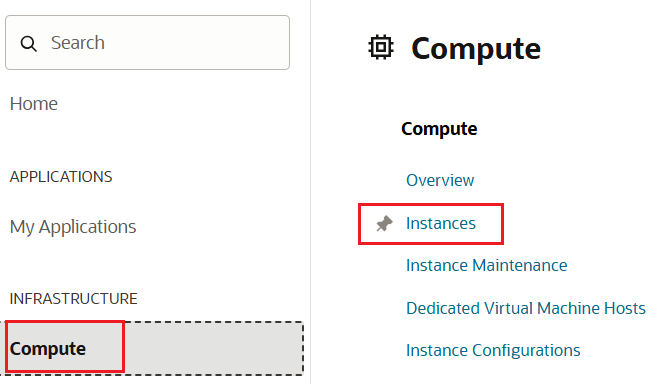
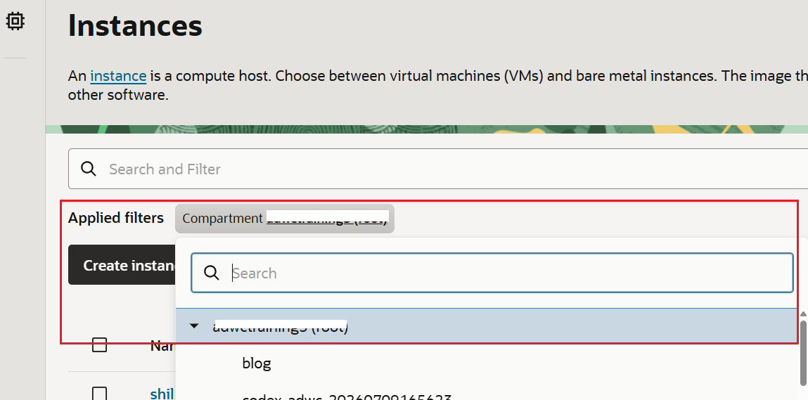
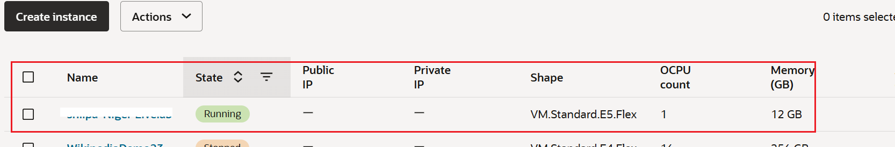
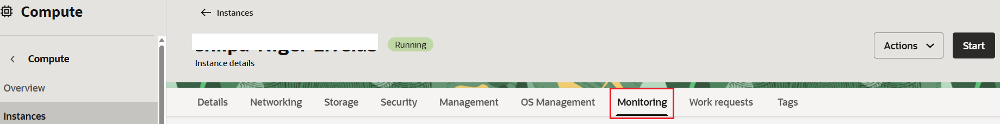
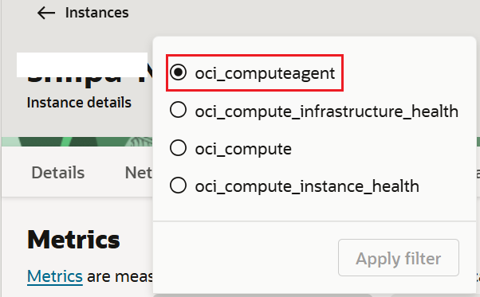
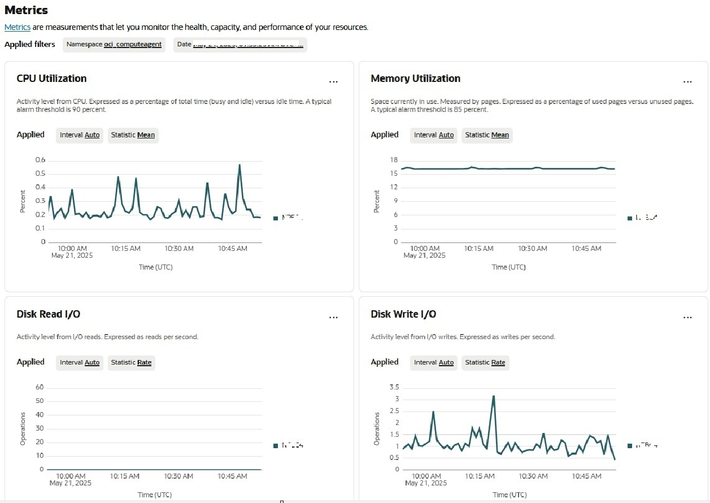
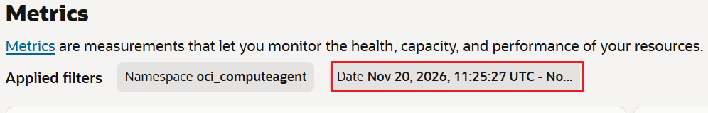
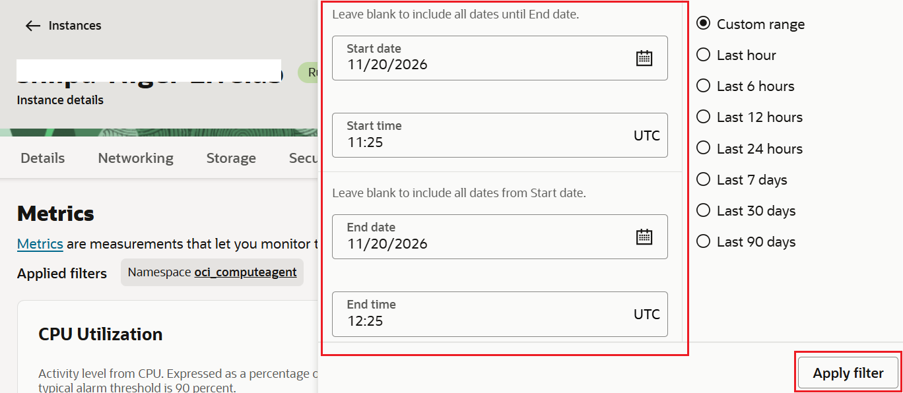

# Monitor OCI Compute Instance Performance

## Introduction

A performance issue can originate outside the database. High resource usage on an application-tier compute instance can increase response time and reduce throughput. OCI Monitoring provides CPU, memory, disk, and network metrics that help you determine whether the compute node contributed to the issue.

In this lab, you open the metrics for an OCI compute instance, review the affected time period, compare it with a known-good period, and record evidence for a performance investigation.

Estimated Time: 10 minutes

### Objectives

In this lab, you will:

- Open the **Monitoring** metrics for an OCI compute instance.
- Review CPU, memory, disk, and network activity during the affected period.
- Compare the affected period with a known-good period.
- Record findings that can be correlated with database performance evidence.

### Prerequisites

- You are already signed in to the Oracle Cloud Console.
- An OCI compute instance hosts the application or another component in the workload path.
- You have permission to view the compute instance and its **Monitoring** metrics.
- You know the approximate start and end time of the performance issue, including the time zone.
- You know a comparable known-good period, when available.
- The **Compute Instance Monitoring** plugin is enabled and running on the instance.

> **Note:** The instance must be able to reach the Monitoring service through a public IP address or a service gateway. If the charts do not contain data, verify the **Oracle Cloud Agent** configuration and network connectivity.

## Task 1: Open the Compute Instance Metrics

1. Open the **Navigation** menu. Select **Compute**, and then select **Instances**. The **Instances** page opens.

    Confirm that the **Region** shown in the Console is the same region in which you created the instance during the **Create Compute Nodes** lab.

    

2. From the **Compartment** list, select the same compartment that you selected in the **Create in compartment** field during the **Create Compute Nodes** lab.

    The **Instances** page refreshes and displays the compute instances in that compartment.

    

3. In the **Instances** list, locate the instance whose **Name** you entered during the **Create Compute Nodes** lab. Confirm that its state is **Running**, and then select the instance name to open the instance details page.

    > **Note:** The **Create Compute Nodes** lab does not prescribe a fixed instance or compartment name. Use the name and compartment that you chose when you created the instance.

    

4. On the instance details page, select **Monitoring**, and then select **Metrics**. In the classic Console layout, select **Metrics** under **Resources**.

    

5. From the **Metric namespace** list, select **oci_computeagent**.

    

    The **Metrics** page displays the default charts for the selected compute instance.

    

## Task 2: Select the Investigation Period

1. Under **Applied filters**, select **Date**.

    

2. In the time-range dialog, select **Custom range**. Enter a start date and time and an end date and time that include the complete performance issue, and then click **Apply filter**.

    

3. Record the selected start time, end time, and time zone. Use the same period when you review database evidence such as ASH, AWR, SQL Monitor, or Performance Hub.

4. Repeat the review for a comparable known-good period. When possible, choose a period with a similar workload so that the comparison is meaningful.

## Task 3: Review the Compute Metrics

Review the following charts for sustained resource pressure, unusual spikes, and differences between the affected period and the known-good period:

- **CPU Utilization** and **Load Average** - Check for sustained high activity or a clear increase that occurs at the same time as the reported slowdown.
- **Memory Utilization** and **Memory Allocation Stalls** - Check for sustained memory pressure or allocation stalls during the affected period.
- **Disk Read/Write Bytes** and **Disk Read/Write I/O** - Check for an unusual increase in disk throughput or operations. To investigate a specific volume, open its **Metrics** page and review the **oci_blockstore** charts.
- **Network Receive/Transmit Bytes** - Check for a throughput change that occurs at the same time as the issue. To investigate a specific VNIC, review its **oci_vcn** metrics.

> **Important:** A single high metric does not identify the root cause by itself. Correlate the compute activity with the workload and database evidence before changing the instance shape or adding capacity.

## Task 4: Record and Share the Findings

1. Record the instance name, compartment, region, shape, OCPU count, and memory allocation.

2. Capture the charts for both the affected period and the known-good period. Include the time range and time zone.

3. Summarize which metrics changed, whether the changes occurred at the same time as the performance issue, and whether compute resource pressure was observed.

4. Attach the findings and the corresponding database evidence to the performance investigation or Oracle Support Service Request.

You now have compute-node evidence that can help confirm or exclude application-tier resource pressure as a contributor to the performance issue.

## Troubleshooting: No Metric Data

If the **Metrics** page does not display charts with data, complete the following checks:

- On the instance details page, select **Management**, and then select **Oracle Cloud Agent**. Confirm that the **Compute Instance Monitoring** plugin is enabled and running.
- Confirm that the instance uses a supported image and that **Oracle Cloud Agent** is installed.
- Confirm that the instance can reach the **Monitoring** service through a public IP address or a service gateway.
- Confirm that your IAM policy permits access to the instance and its **Monitoring** metrics.

## Learn More

- [Compute Instance Metrics](https://docs.oracle.com/en-us/iaas/Content/Compute/References/computemetrics.htm)
- [Viewing Default Metric Charts for a Single Resource](https://docs.oracle.com/en-us/iaas/Content/Monitoring/Tasks/view-chart-resource.htm)
- [Enabling Monitoring for Compute Instances](https://docs.oracle.com/en-us/iaas/Content/Compute/Tasks/enablingmonitoring.htm)

You may now **proceed to the next lab**.

## Acknowledgements

- **Authors** - Shilpa Sharma, Principal User Assistance Developer
- **Contributors** - Nigel Bayliss, Product Management Architect
- **Last Updated By/Date** - Shilpa Sharma, November 2026
