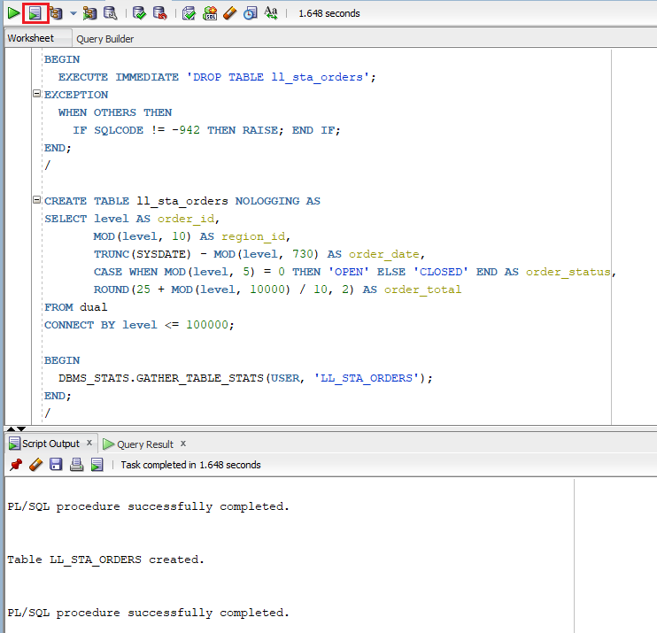
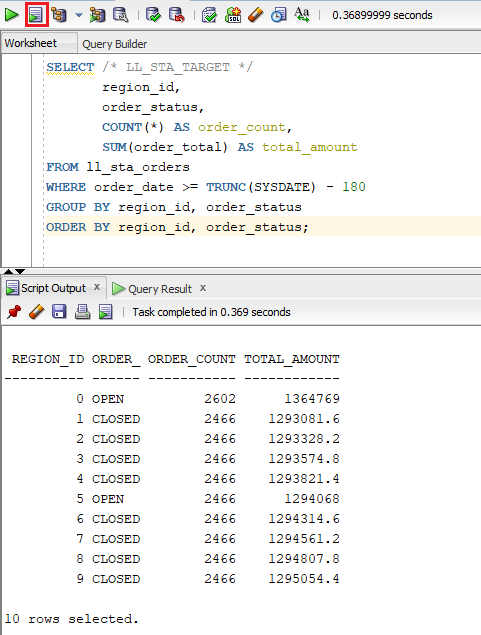
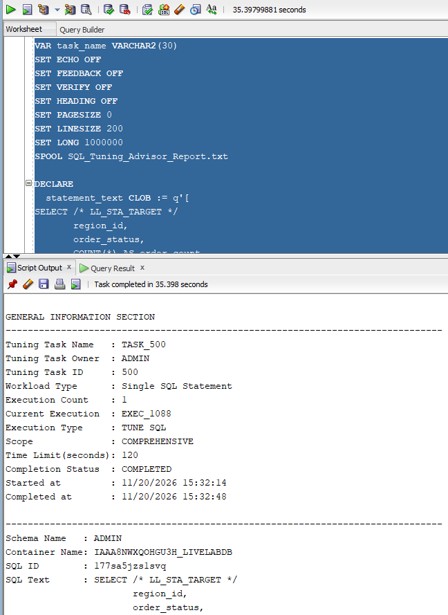

# Generate a SQL Tuning Advisor Report

## Introduction

In this lab, you create a small test workload in Oracle Autonomous AI Database Serverless, run SQL Tuning Advisor, and save its report. You then learn how to attach the report to an Oracle Support Service Request. This lab focuses on report generation and handoff; detailed analysis of the recommendations is not required.

Estimated Time: 20 minutes

### Objectives

In this lab, you will:

- Create and run a test SQL workload.
- Generate a SQL Tuning Advisor report.
- Save the report and attach it to an Oracle Support Service Request when needed.
- Remove the lab table after completing the lab.

### Prerequisites

- You have completed the previous labs to provision an Oracle Autonomous AI Database and connect using SQL Developer Desktop.
- Your database account has the `ADVISOR` privilege.
- Use a non-production lab schema. The setup script recreates the `LL_STA_ORDERS` table.
- To complete the Support handoff task, you have access to the relevant Oracle Support Service Request.

## Task 1: Create a Test Workload

1. Open SQL Developer Desktop and connect to your non-production Autonomous AI Database schema.

2. Download [Create the SQL Tuning Advisor workload](files/create-sql-tuning-advisor-workload.sql), open it in a SQL Worksheet, and run it using **Run Script** or **F5**. The script recreates `LL_STA_ORDERS`, populates it with sample data, and gathers optimizer statistics.

    > **Note:** Run this script only in your lab schema. Any existing table named `LL_STA_ORDERS` in that schema is dropped.

    Confirm that the Script Output reports that `LL_STA_ORDERS` was created and the PL/SQL blocks completed successfully.

    

3. Run the following target query. This is the statement SQL Tuning Advisor will analyze.

    ```sql
    <copy>
    SELECT /* LL_STA_TARGET */
           region_id,
           order_status,
           COUNT(*) AS order_count,
           SUM(order_total) AS total_amount
    FROM ll_sta_orders
    WHERE order_date >= TRUNC(SYSDATE) - 180
    GROUP BY region_id, order_status
    ORDER BY region_id, order_status;
    </copy>
    ```

    Confirm that the query returns the grouped order data.

    

## Task 2: Generate the SQL Tuning Advisor Report

1. Download [Generate the SQL Tuning Advisor report](files/generate-sql-tuning-advisor-report.sql) and open it in a SQL Worksheet using the same database connection.

2. Review the `SPOOL` command. By default, it writes `SQL_Tuning_Advisor_Report.txt` to the current output folder. To choose another location, replace the filename with a full path to an existing local folder, for example:

    ```sql
    <copy>
    SPOOL C:\LiveLabsNew\SQL_Tuning_Advisor_Report.txt
    </copy>
    ```

3. Run the downloaded script using **Run Script** or **F5**. Do not use **Run Statement**, because the script uses `VAR`, `SET`, and `SPOOL` commands.

4. The script creates a tuning task for the target query, executes the task with a time limit of 120 seconds, and writes the text report to the spool file.

    Confirm that the report displays a **GENERAL INFORMATION SECTION** and that **Completion Status** is `COMPLETED`.

    

5. Open `SQL_Tuning_Advisor_Report.txt` in a text editor and confirm that it contains the report for the `LL_STA_TARGET` statement. Keep the report for the next task.

## Task 3: Attach the Report to Oracle Support

1. If you are collecting this report for an issue being investigated by Oracle Support, open the Service Request for that issue.

2. Attach `SQL_Tuning_Advisor_Report.txt` to the Service Request. If you are completing this lab only for practice, retain the report locally; a new Service Request is not required.

## Task 4: Clean Up

1. When you finish, download and run [Clean up the SQL Tuning Advisor workload](files/cleanup-sql-tuning-advisor-workload.sql) in the same lab schema.

    ```sql
    <copy>
    DROP TABLE ll_sta_orders;
    </copy>
    ```

2. Remove the local report if you no longer need it.

You may now **proceed to the next lab**.

## Acknowledgements

- **Authors** - Shilpa Sharma, Principal User Assistance Developer
- **Contributors** - Nigel Bayliss, Product Management Architect
- **Last Updated By/Date** - Shilpa Sharma, November 2026
