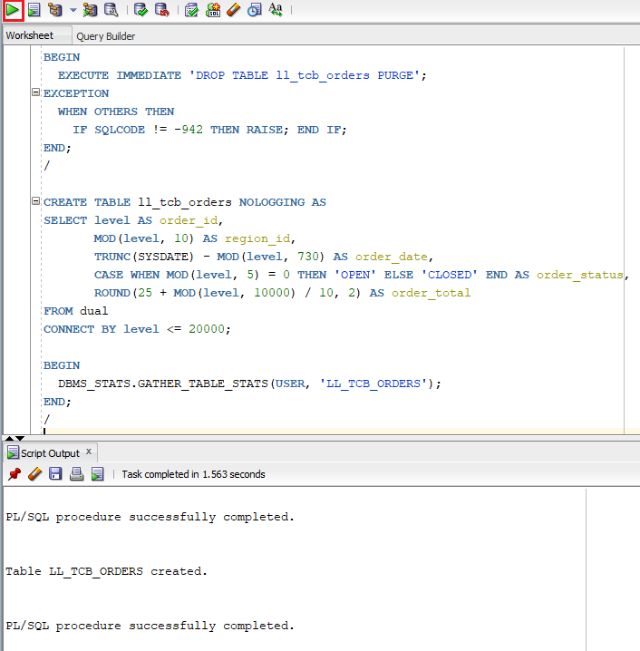
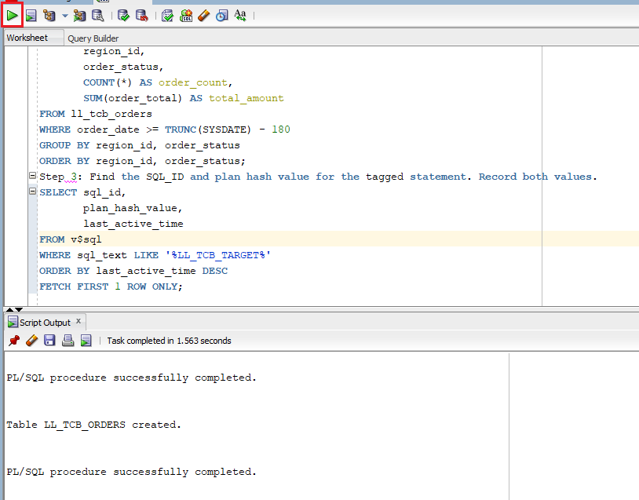
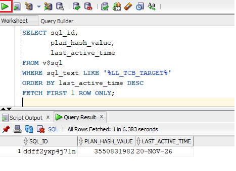
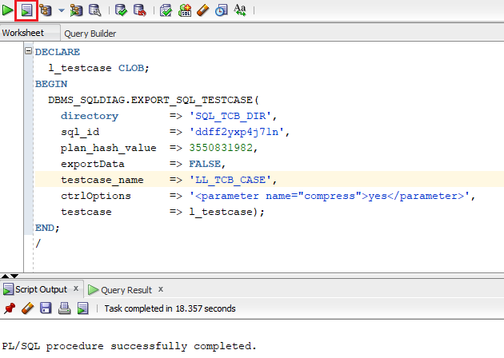
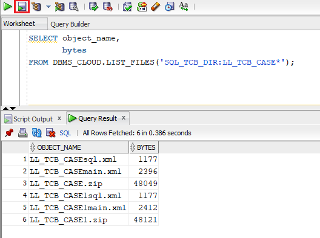

# Generate a SQL Test Case for Oracle Support

## Introduction

SQL Test Case Builder uses `DBMS_SQLDIAG` to package a SQL statement and the related environment details that Oracle Support can use to investigate a SQL performance problem. In this lab, you create a small workload, identify its SQL ID and plan hash value, export a compressed test case, and prepare the ZIP file for a Service Request.

The export in this lab excludes table rows.

Estimated Time: 15 minutes

### Objectives

In this lab, you will:

- Create and run a tagged SQL workload.
- Record the SQL ID and plan hash value.
- Export and verify a compressed SQL test case.
- Transfer the ZIP file and prepare it for an Oracle Support Service Request.

### Prerequisites

- An available Oracle Autonomous AI Database instance.
- A SQL Developer Desktop connection to a non-production schema.
- Your database account has the `ADVISOR` role, access to `V$SQL` and `V$SQL_TESTCASES`, and read/write access to `SQL_TCB_DIR`.
- For the transfer step, an existing `DBMS_CLOUD` credential and an Object Storage bucket that you can write to.

> **Caution:** The workload script recreates `LL_TCB_ORDERS`. Run it only in your lab schema.

## Task 1: Create a Test Workload

Create a small orders table, gather optimizer statistics, and run the tagged query that you will export.

1. Download [Create the SQL Test Case Builder workload](files/create-sql-test-case-workload.sql), and then open the script in a SQL Developer worksheet connected to your lab schema.

2. Select the statements that recreate `LL_TCB_ORDERS` and gather optimizer statistics. Click **Run Script** or press **F5**.

    ```sql
    <copy>
    BEGIN
      EXECUTE IMMEDIATE 'DROP TABLE ll_tcb_orders PURGE';
    EXCEPTION
      WHEN OTHERS THEN
        IF SQLCODE != -942 THEN RAISE; END IF;
    END;
    /

    CREATE TABLE ll_tcb_orders NOLOGGING AS
    SELECT LEVEL AS order_id,
           MOD(LEVEL, 10) AS region_id,
           TRUNC(SYSDATE) - MOD(LEVEL, 730) AS order_date,
           CASE WHEN MOD(LEVEL, 5) = 0 THEN 'OPEN' ELSE 'CLOSED' END AS order_status,
           ROUND(25 + MOD(LEVEL, 10000) / 10, 2) AS order_total
    FROM   dual
    CONNECT BY LEVEL <= 20000;

    BEGIN
      DBMS_STATS.GATHER_TABLE_STATS(USER, 'LL_TCB_ORDERS');
    END;
    /
    </copy>
    ```

    Confirm that the Script Output reports that `LL_TCB_ORDERS` was created and the PL/SQL blocks completed successfully.

    

3. In the same SQL Developer connection, select and run the tagged query.

    ```sql
    <copy>
    SELECT /* LL_TCB_TARGET */
           region_id,
           order_status,
           COUNT(*) AS order_count,
           SUM(order_total) AS total_amount
    FROM   ll_tcb_orders
    WHERE  order_date >= TRUNC(SYSDATE) - 180
    GROUP  BY region_id, order_status
    ORDER  BY region_id, order_status;
    </copy>
    ```

    

4. Immediately run the following query. Record the returned **SQL ID** and **plan hash value**; you will use both values in Task 2.

    ```sql
    <copy>
    SELECT sql_id,
           plan_hash_value,
           last_active_time
    FROM   v$sql
    WHERE  sql_text LIKE '%LL_TCB_TARGET%'
    AND    sql_text NOT LIKE '%v$sql%'
    ORDER  BY last_active_time DESC
    FETCH FIRST 1 ROW ONLY;
    </copy>
    ```

    

> **Note:** The tagged SQL statement must remain in the cursor cache when you export the test case. If the export cannot find it, rerun the tagged query and repeat the SQL ID lookup.

## Task 2: Generate and Verify the Test Case

1. Download [Export the SQL test case](files/export-sql-test-case.sql), and then open it in SQL Developer.

2. Replace `REPLACE_WITH_SQL_ID` and `REPLACE_WITH_PLAN_HASH_VALUE` with the values recorded in Task 1.

3. Click **Run Script** or press **F5**.

    ```sql
    <copy>
    DECLARE
      l_testcase CLOB;
    BEGIN
      DBMS_SQLDIAG.EXPORT_SQL_TESTCASE(
        directory        => 'SQL_TCB_DIR',
        sql_id           => 'REPLACE_WITH_SQL_ID',
        plan_hash_value  => REPLACE_WITH_PLAN_HASH_VALUE,
        exportData       => FALSE,
        testcase_name    => 'LL_TCB_CASE',
        ctrlOptions      => '<parameter name="compress">yes</parameter>',
        testcase         => l_testcase);
    END;
    /
    </copy>
    ```

    Confirm that the Script Output reports **PL/SQL procedure successfully completed**.

    

4. Download and run [Verify the SQL test case export](files/verify-sql-test-case.sql). Replace `REPLACE_WITH_SQL_ID` with the SQL ID recorded in Task 1.

    ```sql
    <copy>
    SELECT testcase_name,
           sql_id,
           status,
           creation_date
    FROM   v$sql_testcases
    WHERE  sql_id = 'REPLACE_WITH_SQL_ID'
    ORDER  BY creation_date DESC
    FETCH FIRST 1 ROW ONLY;
    </copy>
    ```

5. Confirm that `STATUS` is `COMPLETE`. The compressed test case is written to `SQL_TCB_DIR`.

    `exportData => FALSE` prevents table rows from being included. The package contains SQL and environment metadata. Review the package for sensitive identifiers before sharing it.

## Task 3: Transfer the ZIP File and Prepare It for Support

1. Download and run [List the SQL test case files](files/list-sql-test-case-files.sql).

    ```sql
    <copy>
    SELECT object_name,
           bytes
    FROM   DBMS_CLOUD.LIST_FILES('SQL_TCB_DIR:LL_TCB_CASE*');
    </copy>
    ```

2. Locate the `.zip` entry in the results. Record its exact `OBJECT_NAME` and confirm that its size in `BYTES` is greater than zero.

    

3. Download [Copy the SQL test case to Object Storage](files/copy-sql-test-case-to-object-storage.sql).

4. Replace the credential name, Object Storage URI, and ZIP filename with values for your environment. Do not include database credentials in the script.

5. Click **Run Script** or press **F5** to copy the ZIP file to Object Storage.

6. Download the ZIP file from Object Storage to your computer. If Oracle Support requested the test case, attach the ZIP file to the applicable Service Request and include the SQL ID and a short description of the problem.

    For practice only, keep the ZIP file locally; you do not need to create a Service Request.

## Task 4: Clean Up

1. Download and run [Clean up the SQL Test Case Builder lab](files/cleanup-sql-test-case-builder.sql). The script removes `LL_TCB_ORDERS` and the generated `LL_TCB_CASE` files from `SQL_TCB_DIR`.

2. Remove the copied ZIP file from Object Storage when it is no longer needed and your retention policy allows it.

You may now **proceed to the next lab**.

## Learn More

- [Diagnosing and Resolving Problems with SQL Test Case Builder](https://docs.oracle.com/en/database/oracle/oracle-database/26/admin/diagnosing-and-resolving-problems.html)
- [DBMS_SQLDIAG Package Reference](https://docs.oracle.com/en/database/oracle/oracle-database/26/arpls/DBMS_SQLDIAG.html)
- [List Directory Contents in Autonomous AI Database](https://docs.oracle.com/en/cloud/paas/autonomous-database/serverless/adbsb/list-directory-contents.html)
- [DBMS_CLOUD Subprograms](https://docs.oracle.com/en-us/iaas/autonomous-database-serverless/doc/dbms-cloud-subprograms.html)

## Acknowledgements

- **Authors** - Shilpa Sharma, Principal User Assistance Developer
- **Contributors** - Nigel Bayliss, Product Management Architect
- **Last Updated By/Date** - Shilpa Sharma, November 2026
